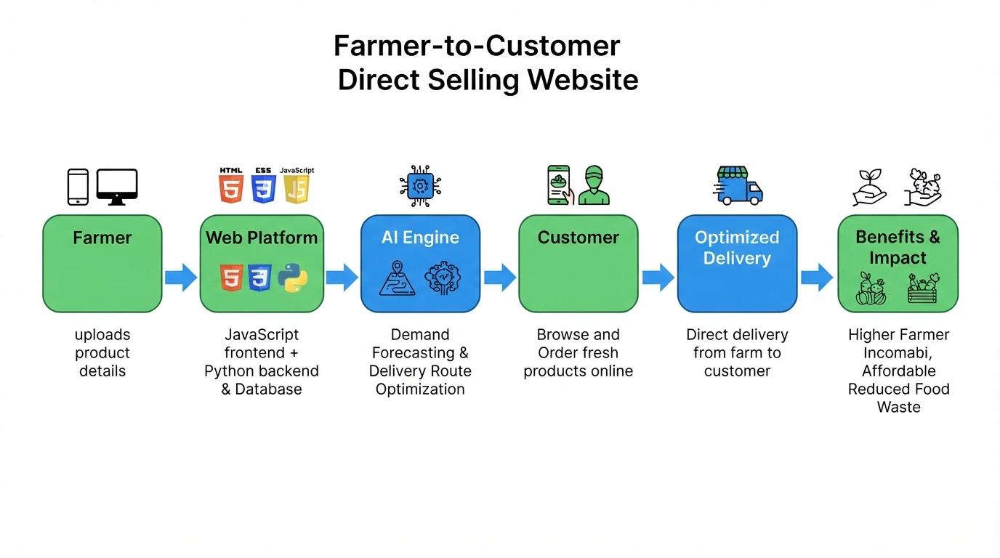

# Smart India Hackathon Workshop
# Date:24.11.2026
## Reference Number:26004112
## Name:Sheno.P

## Problem Title
SIH 26033: Multiple intermediaries reduce farmers earnings and increase consumer prices.

## Problem Creater's Organization
Ministry of Consumer Affairs, Food & Public Distribution

## Theme
Agriculture, FoodTech & Rural Development

## Problem Description
Expected Solution: Create a digital marketplace that:

• Connects farmers/FPOs directly with consumers and bulk buyers.
• Provides logistics support.
• Uses AI for demand forecasting and route optimization.

Benefits:

• Better prices for farmers.
• Lower prices for consumers.
• Reduced supply chain inefficiencies.

## Proposed Solution
Our project is a website that connects farmers directly with customers. Farmers can add their products and sell them online. Customers can easily buy fresh products at a good price. This helps farmers earn more money

## Technical Approach
We will create a website using HTML, CSS and JavaScript. We will use Python for the backend and a database to store details.

AI will help to find product demand and choose better delivery routes.

## Feasibility and Viability
This project is easy to develop using simple technologies. Farmers can use it through mobile phones or computers.

Some farmers may not know how to use online platforms. Internet problems and delivery problems may also happen.

We can solve these problems by making the website simple and easy to use.

## Impact and Benefits
- Farmers can get better prices for their products.
- Customers can buy fresh products at lower prices.
- Farmers can sell products directly to customers.
- Food waste can be reduced.
- It helps farmers and village development
## Research and References

1. e-NAM – https://enam.gov.in/
2. Ministry of Consumer Affairs – https://consumeraffairs.nic.in/